<div align="center">

# Ivory

**Android Runtime & Kernel · Reverse Engineering · Systems & AI-Native Tooling**

<p align="center">
  
</p>

<p align="center">
  <a href="https://ivory.cafe"><strong>ivory.cafe</strong></a> ·
  <a href="https://ivory.cafe/projects"><strong>Projects</strong></a> ·
  <a href="https://ivory.cafe/resume"><strong>Resume</strong></a> ·
  <a href="https://r0dump.com"><strong>r0dump.com</strong></a> ·
  <a href="mailto:contact@ivory.cafe"><strong>contact@ivory.cafe</strong></a>
</p>

<picture>
  <source media="(prefers-color-scheme: dark)" srcset="https://raw.githubusercontent.com/tiwe0/tiwe0/output/pacman-contribution-graph-dark.svg">
  <source media="(prefers-color-scheme: light)" srcset="https://raw.githubusercontent.com/tiwe0/tiwe0/output/pacman-contribution-graph.svg">
  
</picture>

</div>

---

### Overview

Reverse & systems engineer focused on **Android Runtime (`ART` / `DEX` / `JNI`)**, **low-level hooking** (`PTE` page-table switching, `Zygisk`, `LSPlant`, `Xposed`, `Frida`), **protocol / `JSVMP` reconstruction**, and **AI-augmented engineering workflows** built around context architecture, deterministic boundaries, and closed-loop verification.

- **Security Instruction** — Security & Reverse Engineering Lecturer at **Kanxue Academy (Pediy)** *(2026–Present)*
- **Industry Practice** — Reverse & Data Systems Engineer *(2025–Present)*: mobile RPC/`Xposed` collection pipelines, `Unicorn` parameter emulation, and Web `JSVMP` algorithm recovery (`x-gnarly`)
- **Independent Study & R&D** — Systems coursework for **CAS** graduate CS preparation & independent reverse engineering *(2023–2025: `URW` binary diffing & hook PoC, Godot 3 → 4 engine migration, security write-ups)*
- **Vulnerability Research** — Independent Security Contributor @ **TSRC** *(Apr 2022 Single-Vuln Leaderboard #26 — critical authentication bypass in core Tencent service)*
- **Academic Background** — B.S. in **Mathematical Statistics** *(Pilot Program)*, School of Economics, **Xiamen University** *(2018–2023)*

---

### Selected Projects & Research

#### Android Runtime, Kernel & Security

- **[r0dump](https://github.com/tiwe0/r0dump)** · [r0dump.com](https://r0dump.com) · [Technical Note](https://ivory.cafe/posts/r0dump-fart-to-android-16)  
  Active-invocation ART method recovery & DEX unpacking system ported to **Android 16 / LineageOS 23.2** — covering classloader chain capture, in-memory DEX reconstruction, automated diagnostics, and `R0dump Manager`.

- **[Dejavu](https://github.com/tiwe0/Dejavu)**  
  Android `arm64` runtime C compilation & hooking engine embedding **Lua + TinyCC** to compile freestanding C in memory, featuring `dejavuctl` REPL, `hookx` scripting API, optional `Zygisk` / `LSPlant` integration, and 16 KB page-size support across Android 8–15 (API 26–35).

- **[wxshadow-hook-poc](https://github.com/tiwe0/wxshadow-hook-poc)** · [Technical Note](https://ivory.cafe/posts/android-kernel-wxshadow-hook-lab)  
  Android kernel page-level stealth hook lab on Pixel 7 — decomposing `PTE` transactions, shadow/original page views, `IABT`/`DABT` exception routing, page-identity checks, and clean teardown into verifiable states.

- **Protocol & Web Deobfuscation**  
  Pure-Python algorithm reconstruction of TikTok Web `x-gnarly` via AST transformations & `JSVMP` trace instrumentation; `Unicorn`-based native parameter emulation; Cronet & Protobuf traffic-capture modules; distributed `Xposed` collection (~90k records / 48h on 3 devices).

#### Systems, AI Tooling & Graphics

- **[GeoChat](https://github.com/tiwe0/GeoChat)** · [Technical Note](https://ivory.cafe/posts/llm-meets-geogebra)  
  Local-first AI math visualization app (`Tauri` · `React` · `Bun`) driving GeoGebra reliably through explicit syntax boundaries, AST validation, asynchronous command feedback, and native tool calling.

- **LBuild / Lambda64**  
  Secondary development of an `ARM64` operating system & cold-image build system in **Common Lisp** targeting `QEMU virt`, spanning supervisor boot, VirtIO graphics, input, storage, and networking.

- **[Stardew Valley HD-2D](https://github.com/tiwe0/sdv-hd2d-release)** · **Door in the Woods (Godot 3 → 4)** · **[URW Localization PoC](https://ivory.cafe/posts/localization-as-a-systems-project)**  
  Octopath-style 3D stage lighting, shadows, bloom, depth of field & 3D weather SMAPI rendering mod; Godot decompilation, bugfixing, mod loader & engine upgrade to v4; Linux-vs-Windows symbol diffing + `Detours` / DLL injection Chinese rendering PoC.

- **Systems Reading & Open Knowledge**  
  Line-by-line annotated **Linux 0.12** source reader with in-browser `x86` emulator & memory visualizer; Chinese translations of core *Emacs Lisp* documentation, *Frida JavaScript API*, and symmetric shadowcasting algorithms.

---

### Metrics & Activity

<p align="center">
  <picture>
    <source media="(prefers-color-scheme: dark)" srcset="https://raw.githubusercontent.com/tiwe0/tiwe0/cards/github_dark/3-stats.svg">
    <source media="(prefers-color-scheme: light)" srcset="https://raw.githubusercontent.com/tiwe0/tiwe0/cards/github/3-stats.svg">
    
  </picture>
  &nbsp;
  <picture>
    <source media="(prefers-color-scheme: dark)" srcset="https://raw.githubusercontent.com/tiwe0/tiwe0/cards/github_dark/1-repos-per-language.svg">
    <source media="(prefers-color-scheme: light)" srcset="https://raw.githubusercontent.com/tiwe0/tiwe0/cards/github/1-repos-per-language.svg">
    
  </picture>
</p>

Last 7 days (WakaTime):
<!--START_SECTION:waka-->

```txt
No activity tracked
```

<!--END_SECTION:waka-->

---

### Core Stack

<p align="center">
  
  
  
  
  
  
  
  
  
  
  
  
  
  
  
  
  
  
  
  
  
  
  
  
  
  
  
  
  
  
  
</p>

---

<div align="center">

**Contact** — [contact@ivory.cafe](mailto:contact@ivory.cafe) · WeChat: `I0v0ry` *(please include context)* · Blog & Notes: [ivory.cafe](https://ivory.cafe)  
*Open to remote engineering roles, security research, technical instruction, and focused consulting.*

<br>


</div>
