# 👾 Reverse Engineer | Security Lecturer | Independent Developer

<p align="center">
  
</p>

<picture>
  <source media="(prefers-color-scheme: dark)" srcset="https://raw.githubusercontent.com/tiwe0/tiwe0/output/pacman-contribution-graph-dark.svg">
  <source media="(prefers-color-scheme: light)" srcset="https://raw.githubusercontent.com/tiwe0/tiwe0/output/pacman-contribution-graph.svg">
  
</picture>

---

<h3 align="left">🔥   My Stats :</h3>

<div align="center">
  
  
</div>

Last week:
<!--START_SECTION:waka-->

```txt
No activity tracked
```

<!--END_SECTION:waka-->

---

<h3 align="left">👩‍💻  About Me</h3>

<p align="left">
🎓 <strong>Education</strong> - Graduated from <strong>Mathematical Statistics</strong> Pilot Program, <strong>School of Economics</strong>, <strong>Xiamen University</strong> with good data intuition and machine learning foundation<br>
🎙️ <strong>Kanxue Lecturer</strong> - Security & Reverse Engineering Lecturer at <strong>Kanxue Academy (Pediy)</strong><br>
🔍 <strong>Reverse Engineer</strong> - Specialized in Android/ART internals, software reverse analysis, and security research<br>
💻 <strong>Independent Developer</strong> - Full-stack development across Web / PC / App platforms<br>
⚙️ <strong>Security Researcher</strong> - Security Researcher at Tencent Security Emergency Response Center<br>
🏆 <strong>Achievement</strong> - Reported Tencent email random login vulnerability, ranked 26th in April 2022 single vulnerability leaderboard<br>
🧩 <strong>Tech Stack</strong> - C++ / Python / JavaScript / Lua / Frida / Zygisk / IDA Pro / Ghidra<br>
🎮 <strong>Game Dev</strong> - Independent game development, rendering mods, and reverse engineering
</p>

---

<h3 align="left">🚀 Featured Projects</h3>

<div align="left">

#### 🕷️ Android, Web & Mobile Security Research
- **[r0dump](https://github.com/tiwe0/r0dump)** - Android 16 ART-integrated DEX dumper & repair toolkit inspired by FART, featuring in-memory DEX reconstruction, R0dump Manager, and portable AOSP/LineageOS patches
- **[Dejavu](https://github.com/tiwe0/Dejavu) & [wxshadow-hook-poc](https://github.com/tiwe0/wxshadow-hook-poc)** - Lightweight Zygisk-based Android hooking toolkit for agile AI-era workflows, alongside stealth native hooking research
- **TikTok Web Reverse Analysis** - Utilized AST tree transformation, symbolic execution, and JSVMP trace analysis to successfully reverse x-gnarly algorithm and web environment detection mechanisms
- **Temu App Reverse Analysis** - Analyzed mobile application packet sending processes, business logic, and package encryption algorithms using Frida framework

#### 🤖 AI & Development Tools
- **[GeoChat](https://github.com/tiwe0/GeoChat)** - Local-first AI math visualization desktop app integrating LLMs with GeoGebra via Tauri, React, Bun, syntax parsing, AST validation, and native tool calling

#### 🎮 Game Reverse Engineering & Development
- **[Stardew Valley HD-2D](https://github.com/tiwe0/sdv-hd2d-release)** - Octopath Traveler–style HD-2D rendering SMAPI mod for Stardew Valley with 3D lighting, shadows, bloom, depth of field, and 3D weather
- **URW Game Localization Project** - Independent game Chinese localization based on Detours Hook and DLL injection technology, utilizing IDA Pro, Frida, and patching techniques for complete localization
- **Door in the Woods Mod Loader** - Used open-source Godot reverse tools, upgraded game engine to v4.0, fixed reverse engineering errors, refactored project, and added mod loading functionality
- **Else Heart.Break-style RPG Game** - Currently developing a role-playing game using C/C++, OpenGL, and LuaJIT technology stack *(In Development)*

</div>

---

<h3 align="left">🏆 Achievements & Recognition</h3>

<div align="left">

- 🎙️ **Kanxue Lecturer** - Security & Reverse Engineering Lecturer at Kanxue Academy (Pediy)
- 🥇 **Security Research** - Tencent Security Emergency Response Center Researcher (April 2022 - Rank #26)
- 🎯 **CTF Competitions** - Active participant in cybersecurity capture-the-flag events
- 🔍 **Vulnerability Research** - Discovered critical authentication bypass in Tencent Email System
- 📚 **Academic Excellence** - Mathematical Statistics Pilot Program Graduate with ML expertise

</div>

---

<h3 align="left">💡 Core Competencies</h3>

<div align="left">

#### 🔐 Security & Reverse Engineering
- **Binary Analysis**: IDA Pro, Ghidra for software analysis
- **Dynamic Analysis**: Frida hooking, Zygisk/ART instrumentation, Detours & DLL injection, patching techniques
- **Web Security**: JavaScript AST manipulation, symbolic execution, JSVMP analysis
- **Mobile Security**: Android system/ART customization, unpacking (`r0dump`), and encryption analysis

#### 💻 Software Development
- **Systems Programming**: C/C++, OpenGL graphics, LuaJIT integration
- **Desktop & Web Development**: Tauri, React, Next.js, FastAPI, Bun, full-stack architecture
- **Game Development**: Godot engine modification, SMAPI rendering pipelines, mod loading systems
- **AI/ML Integration**: Agentic tool calling, LangChain, syntax parsing, AST validation

#### 🛡️ Research & Analysis
- **Algorithm Reconstruction**: Reverse engineering proprietary algorithms (`x-gnarly`)
- **Environment Detection**: Web environment detection, anti-debugging, and evasion technique analysis
- **Cryptographic Analysis**: Mobile app encryption protocol reverse engineering
- **Engine & System Optimization**: Game engine upgrades, code refactoring, and system enhancement

</div>

---

<h3 align="left">🎯 My Interests</h3>

<div align="center">

<p align="center">
  <strong>🔍 Technical Interests:</strong><br>
  👾 Complex reverse engineering challenges<br>
  🔑 Security research and vulnerability discovery<br>
  🎮 Game development and engine optimization<br>
  🤖 AI-powered development tools<br>
  🔬 Algorithm reconstruction and analysis<br>
  ⚡ Low-level programming and performance optimization
</p>

<p align="center">
  <strong>🧭 Professional Focus:</strong><br>
  🏢 Security Research positions<br>
  🔧 Reverse Engineering roles<br>
  💻 Full-Stack Development opportunities<br>
  📋 Consulting and freelance projects
</p>

<p align="center">
  <strong>📧 Open to:</strong><br>
  💼 Collaboration and new opportunities<br>
  🌐 Technical discussions and knowledge sharing<br>
  🤝 Industry networking and partnerships
</p>

<p align="center">
  <strong>📬 Contact Information:</strong><br>
  📧 Email: <strong>contact@ivory.cafe</strong><br>
  💬 WeChat: <strong>I0v0ry</strong><br>
  📝 Please specify your purpose when contacting
</p>

</div>

---

<h3 align="left">🛠 Language and tools</h3>

<div align="center">
  
  
  
  
  
  
  
  
  
  
  
  
  
  
  
  
  
  
  
  
  
  
  
  
  
  
  
  
  
</div>

---

<div align="center">
  
</div>
